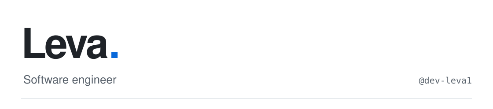

<picture>
  <source media="(prefers-color-scheme: dark)" srcset="./assets/banner-dark.svg">
  <source media="(prefers-color-scheme: light)" srcset="./assets/banner-light.svg">
  
</picture>

  
I build software with a focus on **backend architecture**, **game systems**, and **developer tools**.

  

<a href="https://github.com/dev-leva1?tab=repositories">

</a>

### Featured work

<table>
  <tr>
    <td width="50%" valign="top">
      <strong><a href="https://github.com/dev-leva1/animeportal">Anime Portal</a></strong>
      
A modern web application for exploring anime and manga, built with React, TypeScript, and Vite.

      TypeSctipt · Vite · Jikan API
    </td>
    <td width="50%" valign="top">
      <strong><a href="https://github.com/dev-leva1/altv-dev-tools">alt:V Developer Tools</a></strong>
      
In-game developer utilities and debugging tools for alt:V multiplayer servers.

      JavaScript · Developer tooling
    </td>
  </tr>
</table>

### Technology

### GitHub activity

<table>
  <tr>
    <td width="50%" valign="top">
      <picture>
        <source media="(prefers-color-scheme: dark)" srcset="https://ghstats.dev/api/card?username=dev-leva1&amp;bg=0d1117&amp;text=c9d1d9&amp;title_color=f0f6fc&amp;icon_color=58a6ff&amp;border_color=30363d&amp;size=compact">
        <source media="(prefers-color-scheme: light)" srcset="https://ghstats.dev/api/card?username=dev-leva1&amp;bg=ffffff&amp;text=24292f&amp;title_color=1f2328&amp;icon_color=0969da&amp;border_color=d0d7de&amp;size=compact">
        
      </picture>
    </td>
    <td width="50%" valign="top">
      <picture>
        <source media="(prefers-color-scheme: dark)" srcset="https://ghstats.dev/api/langs?username=dev-leva1&amp;bg=0d1117&amp;text=c9d1d9&amp;title_color=f0f6fc&amp;border_color=30363d&amp;layout=compact&amp;max_langs=7">
        <source media="(prefers-color-scheme: light)" srcset="https://ghstats.dev/api/langs?username=dev-leva1&amp;bg=ffffff&amp;text=24292f&amp;title_color=1f2328&amp;border_color=d0d7de&amp;layout=compact&amp;max_langs=7">
        
      </picture>
    </td>
  </tr>
</table>
